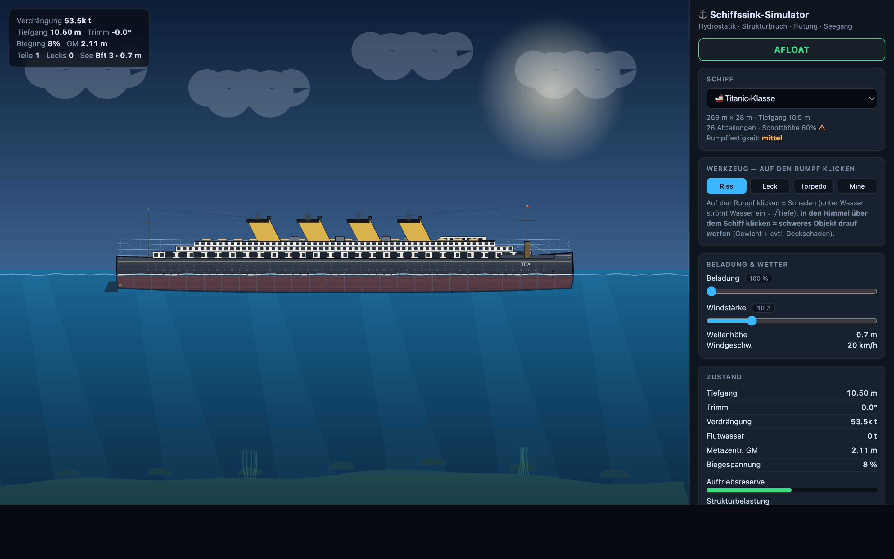

# Ship Sinking Physics Engine

> Why ships sink — two custom physics engines in the browser, without a single library.

An interactive, fully client-side ship-sinking simulator built around **two independent 2D physics engines** written from scratch:

- a **soft-body** mass-spring engine (Verlet / Position-Based Dynamics), and
- a **rigid-body** hydrostatic naval-architecture model.

It simulates buoyancy, stability, progressive flooding, sea state, and structural failure for seven ship types — entirely in vanilla JavaScript with no build step, no frameworks, and no external dependencies. Each engine is a single self-contained HTML file you can open by double-clicking.

## Features

- **Two independent physics engines** — a soft-body mass-spring solver (Verlet / PBD) and a rigid-body hydrostatic station model, each implemented from scratch.
- **Hydrostatics** — per-segment buoyancy, draft, trim/pitch, and displacement, calibrated via block coefficient (Cb) so every ship floats at its design draft.
- **Stability analysis** — metacentric height (GM), center of buoyancy (KB), area moment of inertia, and free-surface effect from flood water, with capsize detection.
- **Longitudinal bending** — hull-girder bending moment with inertial relief (d'Alembert), fatigue, and structural failure; the hull can break into multiple pieces at wave nodes.
- **Progressive flooding** — compartment-by-compartment flooding across bulkheads using Torricelli outflow (CD·√(2gh)) through individual leaks and open break edges.
- **Multi-component wave model** — Gerstner waves with a Beaufort wind scale, significant wave height, and adjustable sea state.
- **Seven ship types** — rowing boat, trawler, freighter, container ship, Titanic-class, battleship, and supertanker, each with its own parameters and rendered superstructure (bridges, funnels, containers, guns).
- **Sandbox tools** — cut/leak/torpedo/mine, fixing, repairing, flooding, cutting, and dropping cannonballs and heavy objects onto the deck (soft-body version), plus fire-setting and fire spread with material dependence (soft-body version).
- **Particle system & rendering** — spray, foam, bubbles, debris, fire, and smoke particles on a Canvas 2D renderer with sky/water gradients, automatic camera tracking, and time-lapse.
- **Live telemetry panel** — draft, trim, displacement, flood water, GM, bending stress, reserve buoyancy, and an event log.

## Tech Stack

- **JavaScript** — vanilla ES, `"use strict"`, no frameworks
- **HTML5 Canvas 2D** for all rendering
- **CSS** custom properties (dark theme)
- **No build tool, no dependencies, no external libraries**

## Getting Started

No installation, build, or server required — everything runs client-side in the browser.

1. Clone or download this repository.
2. Open **`schiff_simulator_v5_rigid.html`** in a modern browser (double-click is enough) — this is the more advanced **rigid-body naval-architecture** version.
3. Alternatively, open **`schiff_simulator.html`** — the **soft-body** variant with mass-spring physics and the sandbox tools.

That's it: no `npm install`, no build step, no server.

> Note: The user interface and in-app labels are in German.

## Screenshots

## Project Status

**Prototype.** Functional and self-contained, built as an exploratory physics/simulation project. The two engines take different modeling approaches and are not feature-identical (for example, fire spread and several sandbox tools exist only in the soft-body version).
